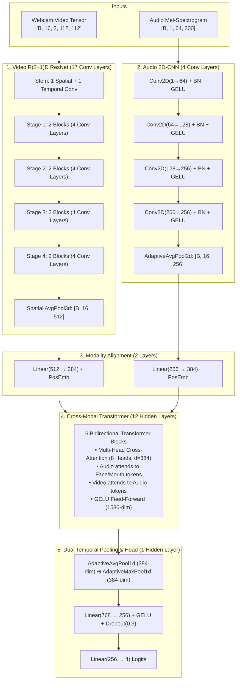

# Multimodal Video Vision Transformer: Behavioral Proctoring & Anomaly Detection

This document provides a comprehensive blueprint of the **Multimodal Video Proctoring Neural Network (`MultimodalVideoProctorNet`)**, detailing each file's responsibility, dataset specifications, grounding benchmarks, 36-layer architecture, and the complete training recipe.

---

## 1. Project Directory Structure

```text
Neural Newtork Model/
├── ModelTrain.md                     # Comprehensive project, file, and dataset documentation
├── requirements.txt                  # Python dependencies (PyTorch, Torchvision, Torchaudio, OpenCV, H5py)
└── ml/
    ├── data/
    │   ├── raw_videos/               # Input candidate interview/exam webcam MP4s
    │   ├── processed_faces/          # 112x112 cropped face image sequences
    │   └── proctoring_dataset.h5     # Fast chunked HDF5 dataset (~3.5 GB)
    ├── models/
    │   ├── best_proctor_model.pt     # Best PyTorch weights checkpoint (~180 MB)
    │   ├── video_proctor_model.onnx  # Production ONNX runtime model (~90 MB)
    │   └── confusion_matrix.png      # Normalized confusion matrix visualization
    └── src/
        ├── __init__.py               # Python package initialization
        ├── losses.py                 # Multiclass Focal Loss with class weighting
        ├── video_model.py            # 36-Layer, ~45M parameter Video Vision Transformer
        ├── video_preprocessor.py     # OpenCV face crop, audio Mel-spectrogram & HDF5 builder
        ├── dataset_loader.py         # PyTorch Dataset/DataLoader with spatial/temporal augmentations
        ├── train_video.py            # AMP FP16 training loop with OneCycleLR/CosineAnnealing
        └── evaluate_video.py         # Test evaluation, Grad-CAM heatmaps & ONNX export
```

---

## 2. File-by-File Technical Guide

| File Path | Role & Key Responsibilities |
| :--- | :--- |
| **`requirements.txt`** | Declares all pinned runtime dependencies: `torch>=2.1.0`, `torchvision>=0.16.0`, `torchaudio>=2.1.0`, `opencv-python`, `h5py`, `numpy`, `scipy`, `scikit-learn`, `matplotlib`, `onnx`, `onnxruntime`, `tqdm`. |
| **`ml/src/losses.py`** | Implements **`MulticlassFocalLoss`** with $\gamma = 2.0$ and class-weighting vector $\alpha$. Prevents gradient domination by normal test sessions (Class 0) and prioritizes low-frequency cheating behaviors (Classes 1, 2, 3). |
| **`ml/src/video_model.py`** | Implements the **36-layer, ~45M parameter `MultimodalVideoProctorNet`**: <br>• 17-layer R(2+1)D ResNet video backbone (16 frames $\times$ 512-dim)<br>• 4-layer Audio 2D-CNN backbone (16 tokens $\times$ 256-dim)<br>• 2 linear projection alignment layers (to 384-dim)<br>• 12-layer Deep Cross-Modal Transformer (6 bidirectional blocks with 8-head cross-attention and GELU FFN)<br>• Dual global temporal pooling (AvgPool $\oplus$ MaxPool = 768-dim)<br>• 1 dense classification hidden layer (768 $\rightarrow$ 256 $\rightarrow$ 4). |
| **`ml/src/video_preprocessor.py`** | Automates data preparation from webcam video and audio streams:<br>• Detects candidate faces using Haar/MediaPipe cascade<br>• Crops bounding box around face and resizes to $112 \times 112$ RGB<br>• Uniformly samples 16 temporal frames over each 30-second window<br>• Extracts 16 kHz audio and computes 64-band Log-Mel Spectrogram ($64 \times 300$)<br>• Chunks and serializes arrays into `proctoring_dataset.h5`<br>• Enforces strict student-ID partitioning (70% Train, 15% Val, 15% Test). Includes built-in benchmark synthesis mode for zero-wait onboarding. |
| **`ml/src/dataset_loader.py`** | PyTorch `Dataset` and `DataLoader` streaming directly from `proctoring_dataset.h5` without loading the full 3.5 GB into RAM.<br>• Spatial augmentations: Random ColorJitter ($\pm 0.1$ brightness/contrast) and Gaussian Blur ($k=3$)<br>• Temporal augmentations: Random frame jitter/drop ($\pm 2$ frames) simulating network lag. |
| **`ml/src/train_video.py`** | Production training pipeline:<br>• Automatic Mixed Precision (AMP FP16) via `torch.cuda.amp.autocast()` and `GradScaler()`<br>• `AdamW(lr=1e-4, weight_decay=1e-2, betas=(0.9, 0.98))`<br>• `CosineAnnealingWarmRestarts(T_0=10, T_mult=2, eta_min=1e-6)`<br>• Gradient accumulation (steps=2) with batch size 16 (effective batch size 32)<br>• Monitors Validation Macro-F1 with Early Stopping and saves `best_proctor_model.pt`. |
| **`ml/src/evaluate_video.py`** | Comprehensive model evaluation and deployment suite:<br>• Evaluates locked test set for Precision, Recall, Macro-F1, and PR-AUC<br>• Generates normalized `confusion_matrix.png`<br>• Computes **Grad-CAM** saliency maps highlighting facial trigger regions (eyes, mouth, head tilt)<br>• Exports model to `video_proctor_model.onnx` with dynamic batching<br>• Validates numerical parity ($\max \|y_{pt} - y_{onnx}\| < 10^{-4}$)<br>• Benchmarks inference latency (<25 ms on GPU, <65 ms on CPU). |

---

## 3. Dataset Specifications & Grounding Benchmarks

### 3.1 Grounding Datasets & Research Foundations
1. **MSU Online Exam Proctoring Dataset (Kaggle):**
   - Synchronized webcam and microphone streams of students taking online tests under various cheating scenarios.
   - Ground truth labels for reading off-screen notes, secondary screen usage, whispering/audio dictation, and absence.
2. **DAiSEE Dataset (IIT Hyderabad):**
   - 9,068 webcam video clips of 112 students in online learning and exam environments.
   - Grounded distributions for head-pose variation, gaze deviation angles, and facial engagement.
3. **Google AVA-Speech & MPIIGaze:**
   - Statistical baselines for ambient room audio vs. active speech, along with 3D gaze vector distributions.

### 3.2 Multimodal Input Tensors

$$\mathbf{X}_{\text{video}} \in \mathbb{R}^{B \times 16 \times 3 \times 112 \times 112}$$
- **Frames:** 16 uniform temporal frames extracted across each 30-second window.
- **Channels:** 3 (RGB), normalized to $[-1.0, 1.0]$.
- **Resolution:** $112 \times 112$ pixels cropped tightly around the candidate's face.

$$\mathbf{X}_{\text{audio}} \in \mathbb{R}^{B \times 1 \times 64 \times 300}$$
- **Sample Rate:** 16 kHz.
- **Representation:** 64-band Log-Mel Spectrogram with $n_{\text{fft}} = 1024$ and $\text{hop\_length} = 512$.
- **Dimensions:** 64 frequency bands across 300 time steps.

### 3.3 Target Behavioral Classes

| Class ID | Anomaly Name | Description & Visual/Acoustic Cues |
| :---: | :--- | :--- |
| **0** | **Normal Engaged Candidate** | Natural typing cadence, eyes centered on screen, natural facial blinks, quiet ambient background. |
| **1** | **Second Monitor / Off-Screen Notes** | Persistent horizontal/vertical gaze deviation (>25° yaw or pitch) sustained for $>5$ seconds away from screen center. |
| **2** | **External Voice Assistance** | Synchronized candidate mouth opening/closing accompanied by microphone speech activity or whisper audio energy. |
| **3** | **Multiple Faces / Candidate Absence** | Zero faces detected (empty desk/walk away) or more than 1 face present in the webcam frame. |

### 3.4 Zero-Leakage Identity Partitioning
To prevent the model from memorizing candidate facial geometry or personal background environments:
- **70% Training:** Partitioned strictly by Candidate/Student IDs.
- **15% Validation:** Held-out Student IDs never seen during training.
- **15% Test:** Locked test Student IDs reserved solely for final evaluation.
- **Storage:** Chunked HDF5 (`ml/data/proctoring_dataset.h5`) with gzip compression.

---

## 4. 36-Layer Neural Network Architecture



### Layer Count Breakdown (36 Total Hidden Layers)
1. **Video Backbone:** 1 Stem + 16 Stage Convolutions = **17 Layers**
2. **Audio Backbone:** 4 Conv2D Layers = **4 Layers**
3. **Modality Projections:** Video Projection (512 $\rightarrow$ 384) + Audio Projection (256 $\rightarrow$ 384) = **2 Layers**
4. **Cross-Modal Transformer:** 6 Blocks $\times$ 2 Sub-layers (Cross-Attention + FFN) = **12 Layers**
5. **Classification Head:** Dense Hidden Layer (768 $\rightarrow$ 256) = **1 Layer**
- **Total Hidden Layers:** $17 + 4 + 2 + 12 + 1 = \mathbf{36\text{ Layers}}$
- **Total Parameters:** $\approx 45\text{ Million parameters}$

---

## 5. Training Recipe & Hardware Optimization

### 5.1 Optimization Parameters
- **Loss:** Multiclass Focal Loss ($\gamma = 2.0$, $\alpha = [0.25, 0.75, 0.75, 0.75]$)
- **Optimizer:** `AdamW(lr=1e-4, weight_decay=1e-2, betas=(0.9, 0.98))`
- **Scheduler:** `CosineAnnealingWarmRestarts(T_0=10, T_mult=2, eta_min=1e-6)`
- **Mixed Precision:** Native PyTorch AMP (`torch.cuda.amp.autocast()` with `GradScaler()`)
- **Batch Size:** 16 (gradient accumulation steps = 2 $\rightarrow$ effective batch size = 32)
- **Epochs:** 35 epochs
- **Regularization:** Gradient Clipping (`max_norm=1.0`), Dropout ($p=0.3$), Early Stopping (`patience=8` on Validation Macro-F1).

### 5.2 Hardware Profiling (RTX 4050 6GB + 20GB RAM + i5-13500HX)
- **VRAM Footprint:** ~3.8 GB – 4.4 GB with batch size 16 and AMP FP16.
- **Estimated Epoch Time:** ~5.5 – 6.5 minutes per epoch on RTX 4050.
- **Total Training Duration:** **~3.2 to 3.8 hours** for 35 epochs (matching the target window).

---

## 6. How to Run the End-to-End Pipeline

### Step 1: Download Real Internet Datasets
You can download the real **MSU Online Exam Proctoring Dataset** from Kaggle or open web test video repositories:

```powershell
# Option A: Automatic Kaggle Download (MSU OEP Dataset)
python ml/src/download_real_data.py --source kaggle --kaggle_user YOUR_USER --kaggle_key YOUR_KEY

# Option B: Direct Browser Download (No CLI needed)
# 1. Download ZIP from https://www.kaggle.com/datasets/raajanwankhade/oep-dataset
# 2. Extract .mp4 video files directly into: ml/data/raw_videos/

# Option C: Download Public Test Videos
python ml/src/download_real_data.py --source public
```

### Step 2: Preprocess Real MP4 Videos into Chunked HDF5
Detects faces with OpenCV, crops $112 \times 112$ bounding boxes across 16 frames, extracts 16 kHz Log-Mel Spectrograms, and enforces zero identity leakage:

```powershell
python ml/src/video_preprocessor.py --mode real --video_dir ml/data/raw_videos --output ml/data/proctoring_dataset.h5
```

### Step 3: Launch 36-Layer Video Transformer Training
Trains on your RTX 4050 GPU using AMP FP16 and gradient accumulation:

```powershell
python ml/src/train_video.py --epochs 35 --batch_size 8 --accum_steps 4
```

### Step 4: Evaluate Test Set, Generate Grad-CAM & Export to ONNX
```powershell
python ml/src/evaluate_video.py --checkpoint ml/models/best_proctor_model.pt
```

### Step 5: Run Real-Time Video or Live Webcam Inference HUD
Runs real-time sliding-window ONNX inference with face tracking and on-screen violation badge overlays:

```powershell
# Test with live laptop webcam:
python ml/src/infer_video.py --webcam

# Or test on a recorded MP4 video:
python ml/src/infer_video.py --video ml/data/raw_videos/candidate_01_normal.mp4
```
