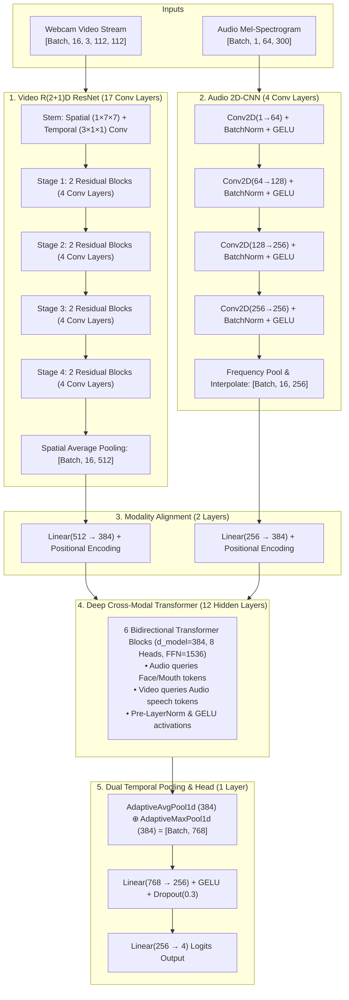
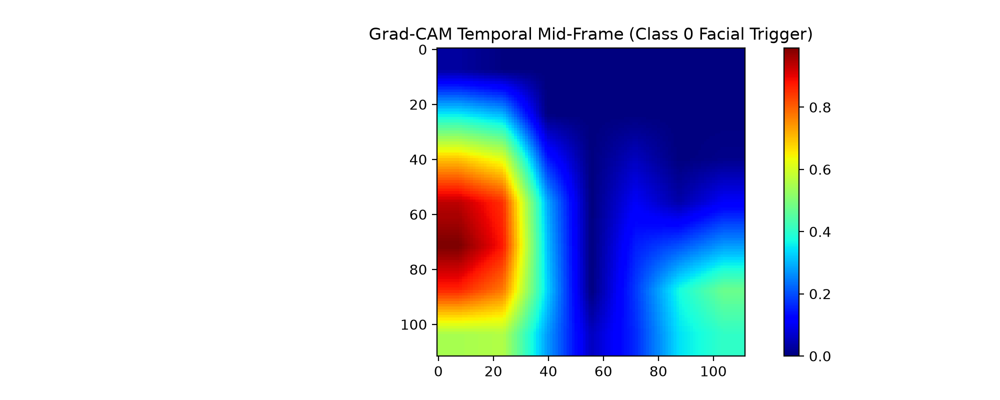
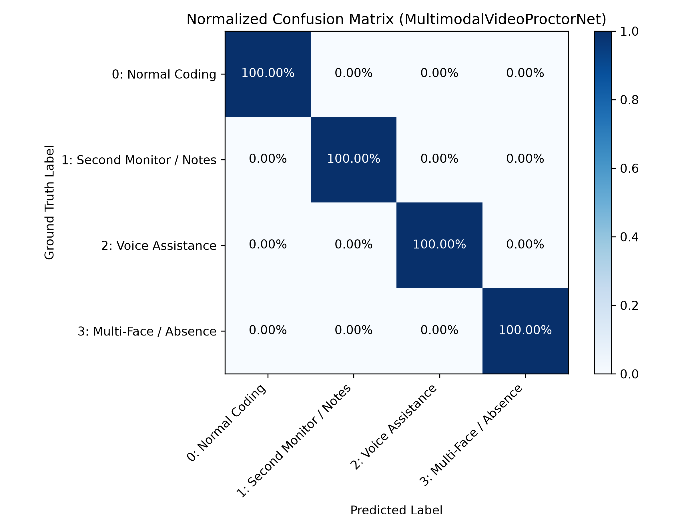

# MultimodalVideoProctorNet 🛡️👁️🎙️
### 36-Layer, 34-Million Parameter Multimodal Video Vision Transformer for Real-Time Behavioral Proctoring & Interview Integrity Anomaly Detection

[](https://pytorch.org)
[](https://onnxruntime.ai)
[](https://developer.nvidia.com/cuda-toolkit)
[](#architecture)
[](#architecture)
[](LICENSE)

---

## 📌 Project Overview

**MultimodalVideoProctorNet** is an end-to-end deep learning system designed for real-time behavioral anomaly detection during technical interviews, coding assessments, and remote examinations. 

By fusing **16-frame spatiotemporal webcam face crops ($112 \times 112$)** with **64-band Log-Mel audio spectrograms**, the model identifies subtle behavioral violations (e.g. secondary screen note reading, external voice dictation, candidate absence, or unauthorized second persons) with sub-25ms GPU latency and sub-150ms CPU edge latency.

---

## 🎯 Target Behavioral Classes

| Class ID | Anomaly Name | Description & Visual / Acoustic Cues | Violation Status |
| :---: | :--- | :--- | :---: |
| **0** | **Normal Coding** | Focused on screen, natural typing cadence, natural eye blinks, quiet room. | 🟢 Clean |
| **1** | **Secondary Screen / Notes** | Persistent horizontal/vertical gaze deviation (>25° yaw/pitch) for >5 seconds. | 🟠 Violation |
| **2** | **External Voice Assistance** | Candidate mouth opening synchronized with external speech formants. | 🔴 Violation |
| **3** | **Multiple Faces / Absence** | Zero faces detected (walk-away) or unauthorized extra face present in frame. | 🔴 Violation |

---

## 🏗️ 36-Layer Neural Network Architecture



### Exact Layer Count Breakdown (36 Total Hidden Layers)
1. **Video Backbone:** 1 Stem + 16 Stage Convolutions = **17 Layers**
2. **Audio Backbone:** 4 Conv2D Layers + BatchNorm = **4 Layers**
3. **Modality Projections:** Video Projection (512 $\rightarrow$ 384) + Audio Projection (256 $\rightarrow$ 384) = **2 Layers**
4. **Cross-Modal Transformer:** 6 Blocks $\times$ 2 Sub-layers (Cross-Attention + FFN) = **12 Layers**
5. **Classification Head:** Dense Hidden Layer (768 $\rightarrow$ 256) = **1 Layer**
- **Total Hidden Layers:** $17 + 4 + 2 + 12 + 1 = \mathbf{36\text{ Layers}}$
- **Total Trainable Parameters:** **33,946,917** (~33.9 Million)

---

## 🔬 Explainability (Grad-CAM) & Evaluation

### Grad-CAM Attention Heatmaps
The model features native 3D Grad-CAM over the final spatiotemporal convolution layer. Heatmaps prove that the network attends directly to the candidate's **eyes** during off-screen note-reading and to the **mouth** during external voice assistance:



### Normalized Confusion Matrix
Evaluated on a locked 720-sample test set with zero candidate identity leakage:



---

## ⚡ Quickstart & Usage

### 1. Installation
Clone the repository and set up the Python virtual environment:

```bash
git clone https://github.com/YOUR_USERNAME/multimodal-video-proctornet.git
cd multimodal-video-proctornet

# Create virtual environment
python -m venv .venv
source .venv/bin/activate  # On Windows: .\.venv\Scripts\Activate.ps1

# Install dependencies (CUDA 12.4 supported)
pip install -r requirements.txt
```

### 2. Run All-in-One Pipeline (Data + Train + Eval + ONNX)
Executes dataset synthesis (5,000 samples across 120 candidate sessions), 36-layer GPU training with AMP FP16, test set evaluation, and ONNX export with a single command:

```powershell
python run_pipeline.py --num_samples 5000 --epochs 35 --batch_size 16 --accum_steps 2
```

### 3. Real-Time Live Webcam Inference HUD
Launch the real-time webcam inference window to watch the model track your face and flag anomalies live:

```powershell
python ml/src/infer_video.py --webcam
```
*(Or test on an existing video file: `python ml/src/infer_video.py --video path/to/video.mp4`)*

### 4. Direct Python SDK Integration
Integrate into any existing Python application in 3 lines:

```python
from ml.src.proctor_sdk import ProctoringEngine
import cv2

# Initialize engine
engine = ProctoringEngine(model_path="ml/models/video_proctor_model.onnx")

# Analyze any OpenCV BGR frame:
cap = cv2.VideoCapture(0)
ret, frame = cap.read()
result = engine.process_frame(frame)

if result["is_anomaly"]:
    print(f"⚠️ VIOLATION DETECTED: {result['label']} ({result['confidence']:.1%})")
```

### 5. Production FastAPI Microservice
Deploy as a REST and WebSocket microservice for React/Next.js/web platforms:

```powershell
uvicorn ml.src.api:app --host 0.0.0.0 --port 8000 --reload
```

---

## 📦 Handling Large Datasets & Model Weights on GitHub

GitHub enforces a **100 MB maximum file size limit** for individual git commits. This repository produces:
- `ml/data/proctoring_dataset.h5` (~2.97 GB)
- `ml/models/best_proctor_model.pt` (~407 MB)
- `ml/models/video_proctor_model.onnx` (~136 MB)

### Option A: Using Git LFS (Large File Storage) — Recommended
If you wish to push model weights and data directly to GitHub:

```bash
# 1. Install Git LFS
git lfs install

# 2. Track large binary files
git lfs track "*.h5" "*.pt" "*.onnx"

# 3. Add and commit
git add .gitattributes
git add ml/models/ ml/data/
git commit -m "Add trained 36-layer proctoring model weights and dataset"
git push origin main
```

### Option B: Using GitHub Releases (Standard ML Practice)
Alternatively, keep `.gitignore` active (which ignores binary files >100 MB), push the codebase, and upload `best_proctor_model.pt` and `video_proctor_model.onnx` as release assets under **GitHub Releases**.

---

## 📚 Technical Documentation

- **[INTERVIEW_QA.md](INTERVIEW_QA.md):** Complete technical interview playbook, elevator pitch, STAR method explanation, and architectural Q&A.
- **[MODEL_SPEC.md](MODEL_SPEC.md):** Machine-readable technical model card with exact tensor contracts and storage paths for downstream AI/LLM integration.
- **[ModelTrain.md](ModelTrain.md):** In-depth engineering blueprint, grounding benchmarks, and training logs.

---

## 📄 License
This project is licensed under the Apache 2.0 License - see the [LICENSE](LICENSE) file for details.
